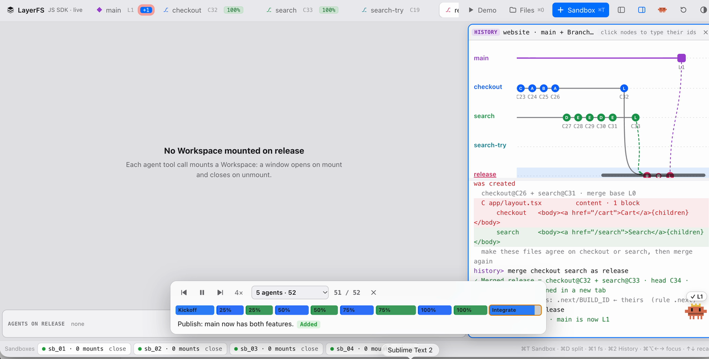

<p align="center">
  
</p>

<h1 align="center">LayerFS</h1>

<p align="center"><strong>Ephemeral Workspaces. Durable Shared History.</strong></p>

<p align="center">
  <a href="LICENSE"></a>
  <a href="release-notes/0.1.7/README.md"></a>
  <a href="docs/assets/community/wechat-ephemeral-ai-lab.jpg"></a>
  <a href="https://discord.gg/DrgJ4DX9E"></a>
  <a href="https://x.com/yifanxu_ephai"></a>
</p>

<p align="center">
  <a href="docs/assets/demo/layerfs-demo.mp4">
    
  </a>
  <br>
  <a href="docs/assets/demo/layerfs-demo.mp4"><strong>▶ Watch the demo (1:37)</strong></a>
</p>

*Five agents build on two Branches in the v0.1.7 live UI. Every tool call
mounts its own Workspace and becomes a Commit; a conflict is resolved, the
Branches merge, and the result is published to `main`.*

> **v0.1.7 Developer Preview:** [release](https://github.com/Ephemeral-AI-Lab/layerfs/releases/tag/v0.1.7),
> [manual](docs/versioned/0.1.7/README.md) and
> [compatibility and waivers](release-notes/0.1.7/README.md).
> 0.1.7 is a rewritten core with a JavaScript SDK and a terminal UI. `main` is
> under development toward [1.0.0](docs/roadmap/1.0/README.md) and is not a
> release.

## 🚀 What is LayerFS?

### Ephemeral Workspaces. Durable Shared History.

LayerFS gives programs and agents **versioned Workspaces over one shared
Store**. Fork a Branch, edit its files directly or in a mounted Workspace where
ordinary commands run, Commit, merge, and publish to `main`.

A Workspace is a complete, writable filesystem view of a Branch head,
including `.git`, dependencies, caches and build output. Mounting it does not
scan or copy the tree, so an agent can take a fresh Workspace for each tool
call, or keep one for a whole task and Commit as it goes. Every Commit is
immutable history in one SQLite Store; content-addressed, chunked and
copy-on-write storage keeps the cost of a new state close to what changed.

> [!WARNING]
> LayerFS 0.1.7 is a Developer Preview for local evaluation, agent-runtime
> integration and research, not production storage. Only the Disposable Store
> profile (WAL, `synchronous=OFF`) runs, there is no crash- or power-loss
> durability, and there is no recovery after a daemon or container restart.
> Keep an independent copy of important data.

## 🧱 How it works

### 🧩 The pieces

| Piece | What it is |
| --- | --- |
| **Project** | Init copies a source directory into one Store file, on a Docker volume that the project's daemons share. |
| **Sandbox** | One container running one LayerFS daemon. It holds zero or more mounted Workspaces. |
| **Workspace** | A writable view of a Branch head, mounted inside a Sandbox. Its uncommitted changes live in its own overlay. |
| **Commit** | Saves a Workspace's changes to its Branch. If the Branch moved since the mount, Commit merges first; a conflict writes markers into the Workspace and commits nothing. |
| **main** | Changes only through `branch.publish`. |

### ⚙️ Storage mechanisms

Every filesystem state is complete logically but incremental physically. Read
the [CAS + CDC + COW foundations](https://learn.layerfs.ai/chapters/01-cas-and-cdc/)
for the design rationale.

| **🔐 01 · Identity** | **📍 02 · Byte locality** | **🌳 03 · Structural locality** |
| --- | --- | --- |
| **Content-addressed storage** — Names immutable objects from their canonical bytes, verifies reads, and reuses exact duplicates across files, Branches and agents. | **Content-defined chunking** — Keeps chunk boundaries stable around localized edits, so changing a small region does not store a whole new large file. | **Copy-on-write** — Rebuilds only the changed files and directory paths when publishing a Commit, preserving unchanged subtrees. |

<p align="left">
  
</p>

*Conceptual view: agents start private Workspaces from different points in one
shared, immutable history.*

---

## 🛠️ Quickstart

0.1.7 is source-only: no npm package, prebuilt daemon or public runtime image is
published. You need **Docker**, **Node 20 or later** and the host Rust toolchain
**`+1.85.1`**.

```bash
git clone https://github.com/Ephemeral-AI-Lab/layerfs.git
cd layerfs
git checkout v0.1.7
```

1. Build the Linux daemon inside the pinned build image, using the command in
   [PHASE5, "Exact Linux build"](core/docs/issues/327/PHASE5-20261015.md).
2. Build the host addon with `npm --prefix sdk/js run build:native`.
3. Set `LAYERFS_HOME`, `LAYERFS_IMAGE`, `LAYERFS_VOLUME` and `LAYERFS_DAEMON`
   as described in the [setup guide](docs/versioned/0.1.7/sdk-and-ui.md#2-setting-up).

```js
import { LayerFS, isRefusal } from "@layerfs/sdk";

const layerfs = new LayerFS("website");        // no I/O yet
await layerfs.project.init("./website");        // once per project

await layerfs.branch.fork("feature");
await layerfs.fs.write("feature", "/README.md", "Hello\n", "Update introduction");

const id = await layerfs.sandbox.create();
const ws = await layerfs.sandbox.mount(id, "feature");
await layerfs.sandbox.exec(id, ws.path, "npm test", "Run tests");
try {
  await layerfs.sandbox.commit(id, ws.path, { message: "Save changes" });
} catch (error) {
  if (isRefusal(error, "Conflict")) console.log(error.detail);  // markers were written
  else throw error;
}
await layerfs.sandbox.unmount(id, ws.path);
await layerfs.sandbox.close(id);
await layerfs.branch.publish("feature");        // main now has feature's files
```

The SDK has 29 methods in four groups: `project`, `fs`, `branch` and
`sandbox`. See the [SDK reference](docs/versioned/0.1.7/sdk-reference.md).

### 🖥️ The LayerFS UI

At v0.1.7 the UI is the terminal page `sdk_sim/tui.html` shown in the demo; see
the [UI guide](docs/versioned/0.1.7/sdk-and-ui.md#5-the-terminal-ui). On
`main` it is replaced by the **LayerFS tab in DeepSeek Harness**, a plugin
bundle under [`dsh/`](dsh/README.md) that draws what each agent did on a
LayerFS project.

## 🗂️ Repository layout

```text
core/              rewritten implementation
  crates/          content, storage, history, persistence, project, telemetry,
                   overlay, workspace, fuse, daemon, sandbox, api and bridge
  docs/            architecture, design contracts and run records
sdk/js/            @layerfs/sdk, its native addon and tests
dsh/               LayerFS plugin bundle for DeepSeek Harness (the UI)
sdk_sim/           simulation engine and demo stories used by the UI
docs/              documentation index, versioned manuals and roadmap
release-notes/     release records, evidence and limitations
tools/             production source-line counter and development tools
```

The v0.1.6 implementation, its CLI and its Rust SDK are retired from `main`;
they remain at the `v0.1.6` release tag.

## ⚠️ Current limitations

- **Breaking release.** 0.1.7 removes the v0.1.6 CLI and Rust SDK, and refuses
  every older Store (including v0.1.6 schema-10 Stores) without migration. SDK,
  addon and daemon must come from the same tag.
- **No restart recovery.** Recovery after a daemon or container restart, and
  replay of an uncertain operation, are not supported.
- **Deferred FUSE behaviour.** Zombie reaping in Sandboxes and kernel requests
  on replaced inodes are deferred; a cancelled command can leave one unreaped
  zombie.
- **Linear scans.** Deep page offsets, Workspace change scans and overlay scans
  walk linearly.
- **No per-file physical sizes.**
- **Durable profile not run.** It compiles but stays disabled by the owner.
- **Waived gates.** 0.1.7 was released with owner waivers and makes no
  performance claim. See the [release record](release-notes/0.1.7/README.md#waivers).

Read the full [known limits](docs/versioned/0.1.7/sdk-and-ui.md#7-known-limits)
before using LayerFS with important data.

## 📚 Documentation

Start with the [documentation index](docs/README.md), or jump directly to a
focused guide:

| Goal | Guide |
| --- | --- |
| Learn the concepts | [Core concepts](docs/general/concepts.md) |
| Set up and use the SDK and UI | [SDK and terminal UI guide](docs/versioned/0.1.7/sdk-and-ui.md) |
| Look up a method | [SDK reference](docs/versioned/0.1.7/sdk-reference.md) |
| Review compatibility and waivers | [0.1.7 release record](release-notes/0.1.7/README.md) |
| Understand the core design | [Cluster-two design index](core/docs/issues/303/README.md) |
| Follow 1.0.0 | [1.0.0 plan](docs/roadmap/1.0/README.md) |
| Read an older release | [Historical manuals](docs/README.md#historical-layerfs-016) |

The [first-principles learning site](https://learn.layerfs.ai/) is educational
material and may describe future work. The versioned repository manual defines
the current product contract.

## 🗺️ Roadmap

| Stage | Focus | Status |
| --- | --- | --- |
| **0.1.0–0.1.6** | One SQLite Store, immutable history, Branches, Workspaces, the CLI and Rust SDK, container FUSE, packed storage and sandbox-local Workspace state. | **Released** as source; see [release-notes](release-notes/). |
| **0.1.7** | Rewritten core: every daemon opens one shared Store, per-Workspace overlays with Commit-time merge, the JavaScript SDK and the terminal UI. | **Released** as source under `v0.1.7` with owner waivers; see the [release record](release-notes/0.1.7/README.md). |
| **1.0.0** | First official release: documentation reorganization, runnable demos, benchmark preparation, troubleshooting telemetry and a live agent build. | **Planned**; owner decisions on compatibility, Store profile, gates and distribution are open. See the [1.0.0 plan](docs/roadmap/1.0/README.md). |

The earlier v0.2.0 and v0.3.0 plans were discarded on 2026-10-15 and are
archived under `docs/roadmap/0.2/`.

## 🤝 Contributing

Bug reports, reproducible performance evidence, documentation corrections and
focused pull requests are welcome. Before opening a change, read
[AGENTS.md](AGENTS.md) and [core/AGENTS.md](core/AGENTS.md) for the repository
rules, and run the checks for the scope you changed.

## 💬 Community

- WeChat: scan the [Ephemeral AI Lab group QR code](docs/assets/community/wechat-ephemeral-ai-lab.jpg). The invitation is time-limited; refresh the image when it expires.
- Discord: [join the Ephemeral AI Lab community](https://discord.gg/DrgJ4DX9E).
- 𝕏: [@yifanxu_ephai](https://x.com/yifanxu_ephai).

<p align="center">
  
</p>

## 📄 License

LayerFS is licensed under the [MIT License](LICENSE).
