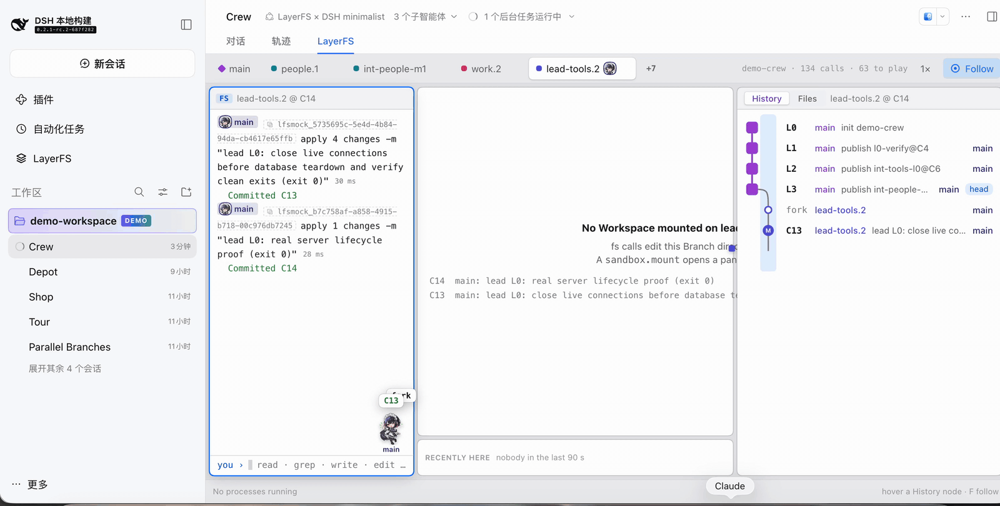

<p align="center">
  
</p>

<h1 align="center">LayerFS</h1>

<p align="center"><strong>Ephemeral Workspaces. Durable Shared History.</strong></p>

<p align="center">
  <a href="LICENSE"></a>
  <a href="docs/roadmap/1.0/README.md"></a>
  <a href="https://x.com/yifanxu_ephai"></a>
</p>

<p align="center">
  
</p>

> **🚀 LayerFS 1.0 arrives October 21, 2026: our first official release.**
> Until then, `main` is under active development toward it.
> [1.0 plan](docs/roadmap/1.0/README.md) ·
> [Latest preview, v0.1.7](https://github.com/Ephemeral-AI-Lab/layerfs/releases/tag/v0.1.7)

> [!WARNING]
> **Locked until October 21, 2026.** LayerFS 1.0 is not released yet. Until
> launch, `main` is a work in progress: the SDK, the Store format and these
> docs may change without notice, and there is no supported install. Please
> wait for the 1.0 release before building on it.

**LayerFS is a versioned filesystem for AI agents.** Every agent gets its own
complete, writable copy of the project in milliseconds, without copying a file.
Every tool call can become a Commit. Agents fork, fork their forks, run in
parallel, merge, and publish, while the whole history of every agent lives in
one small, heavily deduplicated database.

## ✨ Why LayerFS

### 🗜️ Keep every state. Pay only for what changed.

Four storage mechanisms work together, so a new state costs about what changed,
not the size of the project:

| Mechanism | What it does |
| --- | --- |
| **CAS** · content-addressed storage | Identical files and objects are stored once, across every Branch and agent. |
| **CDC** · content-defined chunking | Large files are split at content-defined boundaries, so a small edit changes a few chunks, not the whole file. |
| **COW** · copy-on-write trees | A Commit rewrites only the changed files and their directory path; every unchanged subtree is shared. |
| **Delta encoding** | A changed chunk or file is stored as a compressed delta against its previous version. |

**Measured:** when an agent built an e-commerce site on LayerFS, the history of
every Commit added up to **770 MB of files, stored in a 6.3 MB database —
121× smaller** (58× from deduplication, then 2.4× from compression and deltas).
Reinstalling `node_modules` from scratch added 117 KB, not another copy.
[Evidence](core/docs/issues/334/RESULTS.md#storage-totals-diagnostic-bytes-and-ratios).

### 🌳 Fork anything, at any depth

A Branch can be forked from `main`, from another Branch, or from any past
Commit, and forks can be forked again, to any depth. A fork copies nothing:
it is a new name for an existing state. Each level works independently and
merges back up when it is ready.

```text
main ─┬─ feature ─┬─ feature/try-a ──┐
      │           └─ feature/try-b ──┴─ merge ─► feature ─► publish ─► main
      └─ hotfix  (forked from a Commit three weeks ago)
```

That makes LayerFS fit recursive agent work: a lead agent forks a Branch per
subtask, each subagent forks again to try alternatives, the winners merge up
and the losers are simply dropped.

### 🤖 Built for many agents at once

- **One Workspace per agent, or per tool call.** Mounting a Workspace binds the
  complete tree, including `.git`, dependencies and build output, without scanning
  or copying it. Each Workspace keeps its uncommitted changes in its own overlay.
- **Commits merge, not overwrite.** If the Branch moved since an agent mounted it,
  Commit merges with the new head. A real conflict writes markers into that
  agent's Workspace and commits nothing.
- **Every line has an author.** `blame` traces each line to the Commit that
  wrote it, and the agent UI shows which agent and which call made that Commit.
- **Measured at crew scale:** replaying the first 15 ranges of a real
  repository's history with agent crews made 10,547 Commits from 19,974 SDK
  calls, and hit all 30 planned merge conflicts.
  [Replay statistics](core/docs/issues/352/STATS.md).

### ⚡ Compute and state are separate

Sandboxes are disposable compute; the Store is durable state.

- **File work needs no Sandbox.** `fs` and `branch` calls (read, write, grep,
  diff, fork, merge, publish) run in your own process against the shared Store.
- **Sandboxes only run commands.** A Sandbox is a container that mounts
  Workspaces and runs ordinary commands in them. Closing it loses nothing that
  was committed; a new Sandbox mounts the same Branch.
- **One Store, many Sandboxes.** Every Sandbox opens the same Store directly,
  so no server sits in the data path.

```text
 your agents ──► @layerfs/sdk ──► fs / branch calls ──────────────┐
                      │                                           ▼
                      └──► sandbox calls ──► Sandbox ×N ──► one shared Store
                                             (mount, exec,       (every Commit,
                                              Commit)             every Branch)
```

## 🛠️ Quickstart

```js
import { LayerFS } from "@layerfs/sdk";

const layerfs = new LayerFS("website");
await layerfs.project.init("./website");                 // once per project

await layerfs.branch.fork("feature");                     // no copy
await layerfs.fs.write("feature", "/README.md", "Hello\n", "Update introduction");

const id = await layerfs.sandbox.create("dev", "website", process.env.LAYERFS_IMAGE);
const path = await layerfs.sandbox.mount(id, "feature");  // full tree, no scan
await layerfs.sandbox.exec(id, path, "npm test", "Run tests");
await layerfs.sandbox.commit(id, path, "Save changes");   // merges if feature moved
await layerfs.sandbox.unmount(id, path);
await layerfs.sandbox.close(id);

await layerfs.branch.publish("feature");                  // main now has feature
```

**Requirements:** Linux (ext4, xfs or btrfs) for the Store, Docker for
Sandboxes, Node 20 or later. See the [SDK guide](sdk/js/README.md) for setup
and the 29 SDK methods.

### 🖥️ Watch your agents work

The **LayerFS tab in [DeepSeek Harness](dsh/README.md)** draws what every agent
and subagent does: Branches, Workspaces, Commits, merges and conflicts, live.

## 📚 Documentation

| Goal | Guide |
| --- | --- |
| Find any document | [Documentation index](docs/README.md) |
| Learn the storage model | [CAS, CDC and delta encoding](cas_cdc_deltaencoding_handbook.md) · [learning site](https://learn.layerfs.ai/) |
| Look up a method | [SDK reference](sdk/js/README.md) |
| Use the agent UI | [LayerFS × DeepSeek Harness](dsh/README.md) |
| Read release history | [Release notes](release-notes/) |

## 🗺️ History

| Release | Highlights |
| --- | --- |
| **1.0.0** (coming 2026-10-21) | First official release. |
| 0.1.7 | Rewritten core, per-Workspace overlays, JavaScript SDK. |
| 0.1.0–0.1.6 | Developer Previews: one SQLite Store, Branches, Workspaces, CLI and Rust SDK. |

## 🤝 Contributing

Bug reports, reproducible performance evidence, documentation fixes and focused
pull requests are welcome. Read [AGENTS.md](AGENTS.md) for the repository rules.

## 📄 License

LayerFS is licensed under the [MIT License](LICENSE).
