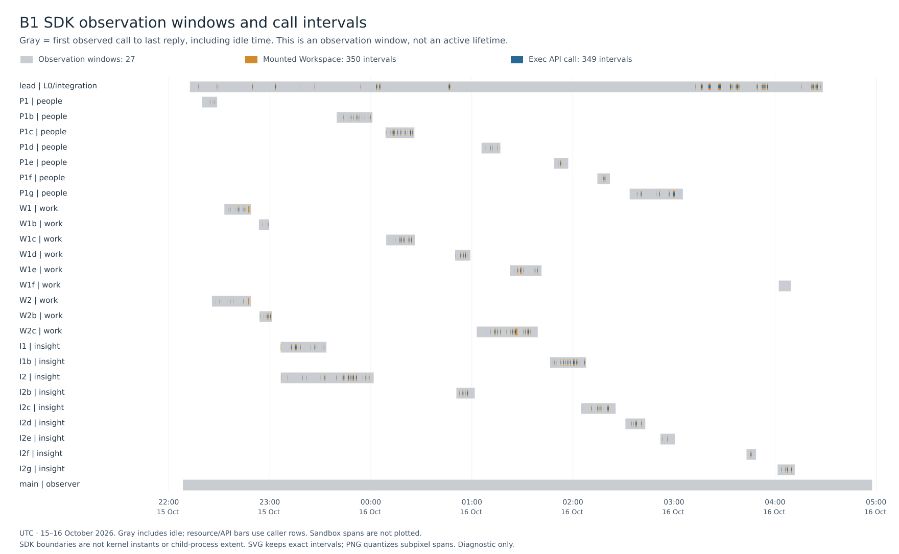
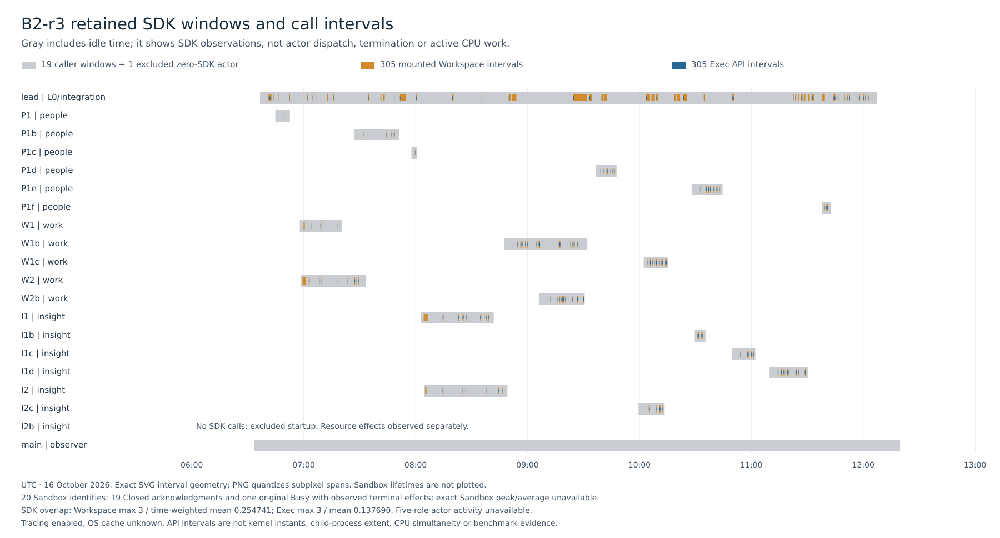

# Crew multi-agent campaign — #340

> **Status:** Archived; retained for historical evidence only.

Build 1 and independent Build 2-r3 each passed the complete frozen application
acceptance on a fresh Branch from its final `main` Layer. Build 1 contains 10,037
production lines and 716 passing meaningful package-test leaves; Build 2-r3
contains 10,005 lines and 624 leaves. Failed B2-r1 and ended B2-r2 remain separate
attempts. The qualifying run retains an excluded startup and procedural deviations.

All figures are diagnostic observations with tracing enabled and unknown OS cache
state. The two applications were written independently and have different source,
test organization and development histories. Their side-by-side figures establish
neither a performance comparison nor a winner. Global Stores used explicit
Disposable/WAL/synchronous=OFF, with `LAYERFS_CONSTRUCTION_WORKERS=1`.
Durable execution is **NOT_RUN — disabled by owner until explicit reauthorization**.

This report is frozen before its own documentation commit and PR merge. Publication
is authorized after the terminal evidence and cleanup checks. Actual documentation
commit, merge, issue operations and their exact LOC comparisons belong to the
separate publication supplement; no future commit or tree is invented here.
Final application/input verification, terminal receipt audit, stopped Store export and all 70 raw archive parts are verified at this boundary. Support capture and Git/issue publication follow the separate disposition in section 11.

## 1. Outcome summary

[Phase A](PHASE-A-RESULTS.md) passed gates A1–A5. The first input freeze preceded
Build 1 Init. The final acceptance of each completed application used its own fresh
Branch, reinstall, build, package tests, frozen source counter, seed, smoke, restart,
pinned Chromium proof, maintained-source audit and fresh-remount proof.

| Build 1 field | Retained result |
| --- | --- |
| Full acceptance | A01–A15 PASS on `acceptance-b1-r3` from exact final main |
| Application size | 10,037 production LOC; 197 production files |
| Package tests | 716 meaningful unique leaves; fail/cancel/skip/todo all 0 |
| Other mode rows | Smoke 35; restart 19; browser 17; audit 20; remount 19; closed 3, all PASS |
| Application team | One lead and 25 worker identities across the five logical roles and successor waves |
| Defined SDK windows | Lead workflow 22,544.170144 s; complete SDK custody 24,550.130214 s |
| LayerFS/SDK/skill changes | Three campaign corrections across Phase A/Build 1; owner PR #343 imported separately |
| Stopped custody | All 31 Sandbox lifetimes closed after both streams; stopped export and complete raw archive verified |

| Independent Build 2-r3 field | Retained result |
| --- | --- |
| Full acceptance | A01–A15 PASS on fresh `acceptance.3` from exact final main |
| Application size | 10,005 production LOC; 208 production files |
| Package tests | 624 distinct named TAP leaves; fail/cancel/skip/todo all 0 |
| Other mode rows | Smoke 28; restart 6; browser 4 interactions plus 1 aggregate wrapper; audit 12; remount 3; process audit 1, all PASS |
| Application team | One fresh lead, 17 normal completed workers, and excluded unused I2b startup; five logical roles scheduled in waves |
| Defined SDK windows | Init 2.588224 s; final acceptance 557.049285 s; lead workflow 19,854.550164 s; total SDK window 20,780.669327 s (definitions below) |
| LayerFS/SDK/skill changes during run | None; all 65 final deployed pins match the pre-Init input set |
| Independence disposition | Fresh standalone inputs and team; T-007 failed startup permanently excluded before any SDK or application contribution |
| Stopped custody and evidence | Full terminal audit PASS: 2,796 trace/full-receipt joins, 305 balanced cycles, 19 selected Closed plus excluded Busy/physical exception, zero volume users; stopped export and 70-part raw archive verified |

| Ended attempt | Disposition | Final acceptance | Retained closure |
| --- | --- | --- | --- |
| B2-r1 | FAILED strict independence, T-005 | A01–A15 NOT_RUN; final LOC/tests unavailable | All three Sandboxes closed; stopped export and raw archive sealed |
| B2-r2 | Ended conservatively over root input custody, T-006 | A01–A15 NOT_RUN; final LOC/tests unavailable | All three Sandboxes closed; stopped export and raw archive sealed |

The completed runs demonstrate ordinary per-step Workspaces, same-Branch Commit
merging and separate Branch integration during a natural application workload.
Functional testing remained necessary after clean textual merges. Exact execution
capacity was four active Codex agents including root, permitting a lead and at most
two active workers. The campaign does not demonstrate five simultaneous workers.

## 2. Identities

Campaign implementation started from main after planning merge
`5d9008e479229f6d29b70923ca76d70bb2744e23`.
The campaign branch is `codex/issue340-node-multiagent`, published through
[PR #344](https://github.com/Ephemeral-AI-Lab/layerfs/pull/344). Planning PR #341
merged at `5d9008e479229f6d29b70923ca76d70bb2744e23`. Owner PR #343 merged to main
at `b0f8e33305f47b37c0b3c66b061318b034434081` and entered this campaign through
`123fee2a22171fdb03ebad69e47f76c46231c763`.

| Freeze | Commit | Manifest SHA-256 | Scope |
| --- | --- | --- | --- |
| 1 | `4308d725fe110ecd787837b1d62ae95dd2d4c664` | `897f623c3b666c621f6bf70852e9cbad6301d343ae6eb96872654522cbb1f718` | Before Build 1 Init |
| 2 | `71c84b54323d19f55c536021acbf14a3b149399c` | `3d4e2543cbf2a6a75b57538501c2e9fe3785d4ef379feffb6e9b8837d73312bf` | Closed-resource P-003/P-002 repair and Build 1 resume |
| 3 | `336dcc455e506902da1cb0384787d7a523cd24e0` | `6f37ec94aa55dd80923d6e07b07971e3bbc436f4be31f2aa99f7e21adcf5015b` | Required R4 rebuild after stopped Build 1; deployed to B2-r1 |
| 4 | `d465bbfa65dcd31cc1b75464fd7464308243a6a3` | `57faef394d7b6f0f53f7f3dacb8731709f4661748d739e6133dc154bd4ef8817` | Generic current-team metadata boundary; B2-r2/r3 |

[Current FREEZE](FREEZE.json) and [archived revisions](frozen/revision-1/FREEZE.json)
retain the exact input sets. Revision 4 changed the inventory boundary and
environment description; the other nine input files, 41 SDK files, nine supplied
skill files and R4 native artifacts stayed unchanged. No new native build is
claimed for that prompt correction or for the later root bookkeeping correction.

The resumed product source is `e6650057906f41c47327a4b67d8cb80f6d2a6bb9`, tree
`3e495801d73a94d43a75c502ada0d1d7653c4e52`. R4 actually built committed tip
`71c84b54323d19f55c536021acbf14a3b149399c`, tree
`cf7a6116066a7c88945194056fa93e893f989850`, with that same product code.
The [four-build identity table](tables/campaign-native-builds-revision4.csv) and
its source sidecar retain the commands and independently rechecked artifacts.
R4 was locked and offline, explicitly reusing worktree-local compiled inputs;
1,221 native and 75 tracked SDK inputs were unchanged and all 16 R3 files were
preserved. Identical R3/R4 artifacts do not imply a new cold Rust compilation.

| Runtime identity | Value |
| --- | --- |
| Runtime image | `sha256:091f785ba7d5d036dfa350e8fd69ee1fcd2d8320c3706841c8c95e6411eee9d2` |
| Runtime Node / npm | 22.23.1 / 10.9.8 |
| Frozen direct npm dependencies | Express 4.22.3; Preact 11.0.1; esbuild 0.28.2 |
| SQLite mode | `node:sqlite` works without a flag; runtime experimental warning retained |
| Browser / driver | 155.0.8059.39 |
| Explicit host controller | `/usr/local/bin/node` 22.7.0 |
| R4 daemon SHA-256 | `47f354e5d92ea9e70032a8a28fbda052292ca761c76dd1e0a076b984247ceb8f` |
| R4 addon SHA-256 | `3cbf8b55fdf2940d422349eb6d82ebc77b9816192f1fa77405f8de963c4b08dc` |
| R4 build identity SHA-256 | `94b411cb62209ae79da97f65717f134f03990e979cc4dc748d178cf454d568b1` |
| Frozen app counter SHA-256 | `f73b6acb7d073e90631936ad62be8705a9c2a2f93c7e2097e7ca4f5c062f12ab` |
| B1 final lockfile SHA-256 | `e19b67dc4155e6cf7f411bf231f73b0abc08b65c4bdd2635e9aefc940addcd64` |
| B2-r3 final lockfile SHA-256 | `06922ecc5ec47d7b094196e2e297082a9b204c9eceb5b6c3414882687a54c6d1` |

The [frozen dependency contract](DEPENDENCIES.md) specifies exactly those three
direct npm dependencies. Chromium, ChromeDriver and Python Selenium are supplied
by the runtime image; no additional npm browser dependency is needed.

Early unqualified host calls selected Node 24 from PATH; every early host runtime
version was not retained. That deviation stays separate from the explicit later
controller and pinned container runtime.

The final 65-pin observation, including frozen inputs, SDK, supplied skills and
native artifacts, is retained externally as
`b2-r3-observation/final-source-pins-r1.json` and the [tracked copy](tables/b2-r3-final-source-pins-r1.json), 16,027 bytes, SHA-256
`241e83e4c34d3c3454bd1397de79e4a0c6eadcd7ccfbafa4a6ed464c0bf51497`.

| Run | Project | Volume | Init Layer |
| --- | --- | --- | --- |
| B1 | `crew-b1-20261016` | `layerfs-issue340-b1-20261016` | `329d37e58a6ffcddcadfebd07f7054a18196a9151f7e5850eed298bcebc047c4bb` |
| B2-r1 | `crew-b2-r1-20261016` | `layerfs-issue340-b2-r1-20261016` | `32be6597b664383e227deafddbd7754de8a7ffb2b0c8d3e0b07304daff115c29e2` |
| B2-r2 | `crew-b2-r2-20261016` | `layerfs-issue340-b2-r2-20261016` | `323c175a0a91498373b7c9bb2707176846f776933a18b65729ec2b264510958d58` |
| B2-r3 | `crew-b2-r3-20261016` | `layerfs-issue340-b2-r3-20261016` | `32d70ae422966a28802e1290e019ff940f39cbc944aca3d1af49fcb7f6d63cf86f` |

| Accepted application | Final main Layer | Source Commit |
| --- | --- | --- |
| B1 | `32d6abffe4095f565d3047a60767ed9ef243d3b5fe6d3de2e00e117d68ffc82f2d` | `12327802b291c700921e35589e71f396bf99b987eea7413a020f6a383fd3128c4b` |
| B2-r3 | `329f2eae880636d0ad253fd53827e4f3d7e6c25bf356726cadc56a134278a8087b` | `1265ae579d077140ca62cca80b1d6a0ffc2a4609abf10755c9f336768f2a728710` |

B2's final main root is
`0e4fb9111aea7c84790838e9174c4ef062a7a00b3175936906e84a8cf7fc3014`.
Its acceptance head is
`126de1a51d38bea94eae673832fe72f7856b86c37dec18200e6b79368681c91ca3`.
Install, bundle and runtime data make later acceptance roots differ from main;
the maintained-source hashes identify the application source being qualified.

## 3. Team and timeline

Phase A2 proved root → lead → worker spawning, direct root/lead/worker messages
and completed-worker slot reuse. An additional simultaneous worker was refused
with `agent thread limit reached`. The resulting schedule used root, lead and at
most two workers at once. W1/W2, I1/I2 and P1 remained five logical roles, with
same-lane pairs overlapping and successors taking bounded milestone work.
Six-process LayerFS load in Phase A3 is a separate proof from Codex agent capacity.

The B1 [agent table](tables/b1-final-primary-r2/b1-agents.csv),
[timeline](tables/b1-final-primary-r2/b1-timeline.csv),
[generation table](tables/b1-final-primary-r2/b1-generations.csv) and
[phase boundaries](tables/b1-final-phase-boundaries-r1/b1-phase-boundaries.csv)
retain identities, actual Branch arguments and source hashes. Some later Insight
and People successors used the shared `work.5-r1` candidate; logical lane labels
do not replace actual mounted Branch arguments.

| Defined B1 interval | Seconds |
| --- | ---: |
| Init SDK call | 0.913672 |
| L0 lead SDK workflow | 348.693514 |
| Post-L0 integration elapsed window | 21,755.480595 |
| Final acceptance-r3 fork through A15 unmount | 372.369002 |
| Lead closure metadata tail | 61.861142 |
| Observer collection tail after lead closure | 1,754.103070 |
| Lead SDK workflow total | 22,544.170144 |
| Complete SDK custody window | 24,550.130214 |

These inclusive intervals overlap and are not additive. The
[B1 concurrency table](tables/b1-final-primary-r2/b1-concurrency.csv) observes
31 Sandbox SDK-custody intervals, 350 Workspace intervals and 349 Exec API
intervals. Known-open Sandbox peak/average were 4/3.029418; known-mounted Workspace
2/0.143344; overlapping Exec API intervals 2/0.135488. Successful SDK replies define
the resource boundaries; neither kernel mount instants nor child-process lifetimes
are inferred. Gray regions in the chart include idle time.

The chart's [source sidecar](tables/b1-sdk-resource-timeline-r2.svg.sources.json)
pins 27 caller windows, 350 Workspace intervals and 349 Exec intervals. The first
chart remains retained as superseded because it conflated a Sandbox creation
caller with its later custodian (E-084).

B2-r3's lead and 17 normal completed workers retained 589 and 1,999 caller
receipts respectively, with 75 and 229 completed mount cycles. The unused I2b
startup made zero SDK calls or mounts. The [closed-worker caller table](tables/b2-r3-development-closed-caller-boundaries-r2.csv)
records first retained SDK caller and sole close caller boundaries for all 17
normal workers; it never substitutes them for exact agent dispatch or final times.
The frozen [lead report](verbatim/b2-r3/lead-REPORT.json) includes role, selected
Sandbox, replacement purpose and original/current metadata projections.
The final [agent table](tables/b2-r3-final-analysis-r1/primary-final-r1/b2-r3-agents.csv),
[timeline](tables/b2-r3-final-analysis-r1/primary-final-r1/b2-r3-timeline.csv) and
[phase-boundary table](tables/b2-r3-final-analysis-r1/phase-boundaries-final-r1/b2-r3-phase-boundaries.csv)
retain source hashes, actual Branches and exact SDK interval definitions.
The phase rows below are inclusive and overlap; they are not additive or exact
actor dispatch/end clocks. The earlier failed formal intervals remain failed.

| Defined B2-r3 interval | Seconds |
| --- | ---: |
| Init SDK call | 2.588224 |
| L0 lead SDK workflow | 368.771478 |
| Post-L0 integration through final main publication | 18,845.744247 |
| Failed formal acceptance1 fork through terminal A10 unmount | 211.589578 |
| Failed formal acceptance2 fork through terminal A06 unmount | 152.505275 |
| Final acceptance3 fork through A15 terminal unmount | 557.049285 |
| Lead closure metadata tail | 79.636879 |
| Observer collection tail after lead close | 736.798163 |
| Lead SDK workflow total | 19,854.550164 |
| B2-r3 complete SDK custody window | 20,780.669327 |

| B2-r3 diagnostic interval or resource metric | Final qualified result |
| --- | --- |
| Defined phase windows | Source-pinned 10-row table above; inclusive and nonadditive |
| Mounted Workspace SDK intervals, peak / weighted average | 3 / 0.254741 across 305 complete SDK intervals |
| Exec API intervals, peak / weighted average | 3 / 0.137690 across 305 complete API intervals |
| Exact open-Sandbox peak / weighted average | UNAVAILABLE: observer Ready-only acquisition and I2b terminal endpoint are uncertain; source disposition in [qualified concurrency table](tables/b2-r3-final-analysis-r1/metadata-final-r1/b2-r3-concurrency.csv) |
| Exact all-five-worker activity duration | UNAVAILABLE: complete dispatch/end boundaries were not retained; four active-agent capacity also rules out five simultaneous workers |

The concurrency window spans 20,780.669327 s from the first Init SDK start to the
last observer close trace reply. The weighted averages use that full window.
The root observer's Ready-only acquisition does not provide an exact Sandbox
creation endpoint; I2b has a separate unknown physical termination endpoint.
Neither is filled with a guessed time. The complete Workspace and Exec metrics
qualify independently.

Close262 returned Busy after terminal effects while create263 overlapped it. A
later absent-container observation is not an exact Sandbox termination clock.
The final concurrency calculation must keep that exception rather than inserting
the Busy reply, a midpoint or the observation-window end as a physical endpoint.
Workspace and Exec metrics qualify independently where their own intervals are
complete. The ended B2 attempts retain separate rosters and lifecycles; their
workers were never pooled into the accepted B2-r3 team.

The [B2 source sidecar](tables/b2-r3-final-analysis-r1/timeline-final-r1/b2-r3-sdk-resource-timeline.svg.sources.json)
pins the renderer, source tables, exact interval counts, font and SVG/PNG hashes.
Gray denotes 19 first-SDK/last-reply observation windows including idle, orange 305
mounted Workspace intervals and blue 305 Exec API intervals by actual caller.
The excluded zero-SDK startup is a text-only row; Sandbox lifetimes are not
plotted. The PNG preview was visually inspected; exact subpixel intervals remain
in the SVG rather than being expanded to a synthetic minimum width.

## 4. SDK operation collection

Primary application/control calls, supplemental metadata observations and internal
or operator calls have separate populations. Medians use `statistics.median`; p95
uses nearest rank `ceil(0.95*n)` on raw milliseconds. Ordinary command syscalls
are not public `fs.*` calls. Daemon phase paths are inclusive, so overlapping
parent/child spans and counter snapshots are not added into synthetic totals.

The B1 [primary manifest](tables/b1-final-primary-r2/manifest.json) covers 3,624
calls with complete receipt joins: 3,513 public, 110 operator and one internal
service call. [Methods](tables/b1-final-primary-r2/b1-methods.csv),
[steps](tables/b1-final-primary-r2/b1-steps.csv),
[refusals](tables/b1-final-primary-r2/b1-refusals.csv),
[phases](tables/b1-final-primary-r2/b1-phases.csv) and
[phase summary](tables/b1-final-primary-r2/b1-phase-summary.csv) retain source
sidecars and per-actor/lane detail.

| B1 primary method | Count | Median ms | p95 ms | Max ms |
| --- | ---: | ---: | ---: | ---: |
| `fs.read` | 1,331 | 4.708 | 24.346 | 39.984 |
| `fs.apply` | 272 | 29.4775 | 45.55 | 62.115 |
| `sandbox.mount` | 350 | 26.8295 | 33.498 | 67.566 |
| `sandbox.exec` | 349 | 5,464.541 | 34,524.049 | 69,081.04 |
| `sandbox.commit` | 350 | 12.497 | 115.512 | 526.965 |
| `sandbox.unmount` | 350 | 7.031 | 10.543 | 26.474 |
| `branch.merge` | 22 | 43.9835 | 136.568 | 151.561 |
| `branch.publish` | 9 | 20.789 | 34.158 | 34.158 |

B1 retained 37 primary refusals: 26 NoSuchPath, four Binary, two AmbiguousMatch,
two Conflict, one Failed and two TooLarge. These include 34 team and three root
product-proof refusals; not every refusal is a defect. The [population tables](tables/b1-final-populations-r1/manifest.json)
retain 511,665 separately joined supplemental metadata calls and combined 515,289
calls, with no unmatched or ambiguous supplemental joins.

B1 numeric daemon coverage contains 3,558 joined scopes and 4,987 complete groups,
with no reply scope missing its retained group. Its full counter CSV has 4,075,702
rows and 1,601,435,388 bytes. The [raw pointer](tables/b1-final-primary-r2/b1-daemon-counters.raw.json)
and [compact summary](tables/b1-final-primary-r2/b1-daemon-counter-summary.csv)
pin the derivative; full logs and failed/partial earlier captures remain raw.

B2-r3's complete primary input contains 2,796 trace/full-receipt joins: 1,999
normal-worker, 588 lead and 209 root calls. The additional lead400 receipt is a
caller-local validation failure, not a traced SDK call. Nine disjoint metadata
waves supply 330,104 supplemental calls with no invalid, ambiguous or unmatched
joins; the arithmetic combined population is 332,900. These metadata observations
remain root work. The [terminal evidence summary](tables/b2-r3-final-evidence-summary.json)
pins normalized calls, normalization and the complete terminal verification.

The primary split is 2,688 public, 107 operator and one internal-service call.
[Methods](tables/b2-r3-final-analysis-r1/primary-final-r1/b2-r3-methods.csv), [steps](tables/b2-r3-final-analysis-r1/primary-final-r1/b2-r3-steps.csv),
[refusals](tables/b2-r3-final-analysis-r1/primary-final-r1/b2-r3-refusals.csv),
[phase paths](tables/b2-r3-final-analysis-r1/primary-final-r1/b2-r3-phases.csv) and
[phase summaries](tables/b2-r3-final-analysis-r1/primary-final-r1/b2-r3-phase-summary.csv) retain per-agent/lane groups,
full source sidecars and the [primary manifest](tables/b2-r3-final-analysis-r1/primary-final-r1/manifest.json).

| B2-r3 primary method | Count | Median ms | p95 ms | Max ms |
| --- | ---: | ---: | ---: | ---: |
| `fs.read` | 858 | 5.1395 | 24.596 | 81.648 |
| `fs.apply` | 191 | 34.064 | 55.704 | 66.167 |
| `sandbox.mount` | 306 | 27.7895 | 41.534 | 56.741 |
| `sandbox.exec` | 305 | 5998.245 | 31992.696 | 52640.008 |
| `sandbox.commit` | 305 | 11.073 | 398.893 | 510.324 |
| `sandbox.unmount` | 305 | 7.118 | 29.139 | 41.907 |
| `branch.merge` | 30 | 67.4825 | 171.442 | 191.953 |
| `branch.publish` | 17 | 18.657 | 39.559 | 39.559 |

The 306 mount attempts include root126's definite NoSuchBranch refusal; the other
305 successful mounts have 305 terminal unmounts. Twenty close attempts comprise
19 Closed and the original Busy exception. The 30 traced refusals are 27
NoSuchPath, one Busy, one NameTaken and one NoSuchBranch; caller-local400 is separate.
Their exact handling and original results are retained, without guessed resends.
The [67 nonzero Exec rows](tables/b2-r3-final-analysis-r1/primary-final-r1/b2-r3-failed-execs.csv) are application/command
outcomes, separate from SDK refusals. The [all-population methods](tables/b2-r3-final-analysis-r1/populations-final-r1/b2-r3-all-methods.csv),
[nine wave rows](tables/b2-r3-final-analysis-r1/populations-final-r1/b2-r3-supplement-waves.csv) and
[population manifest](tables/b2-r3-final-analysis-r1/populations-final-r1/manifest.json) keep primary,
supplemental and combined methods separate. Supplemental 360 file-metadata read
scopes supply 4,320 [phase rows](tables/b2-r3-final-analysis-r1/populations-final-r1/b2-r3-supplement-phases.csv),
with their own [summary](tables/b2-r3-final-analysis-r1/populations-final-r1/b2-r3-supplement-phase-summary.csv).
The [numeric scope coverage](tables/b2-r3-final-analysis-r1/daemon-final-r1/b2-r3-daemon-numeric-scope-coverage.csv)
and [counter summary](tables/b2-r3-final-analysis-r1/daemon-final-r1/b2-r3-daemon-counter-summary.csv)
retain filesystem/Store counters independently of SDK operation counts.

Lead400 is an additional caller-local `fs.list` InvalidInput before SDK trace
admission: it passed an options object as positional `pageSize`. The original
receipt is retained without a fabricated trace, daemon phase or network timing.
The generic normalizer exposes that unmatched raw receipt, and terminal verification
permits only its exact pinned pretrace exception; unknown unmatched receipts still
fail. Later NoSuchPath418 and NameTaken421 are traced refusals with different
identities. Root126's NoSuchBranch refusal and changed root127 final-source proof
are also retained separately (E-116).

The [failed B2-r1 summary](tables/b2-r1-failed/summary.json) retains 145 complete
joins and 33 compact CSVs; its full raw counter derivative is 163,146 rows /
56,684,962 bytes. The [ended B2-r2 summary](tables/b2-r2-failed/summary.json)
retains 61 complete joins, zero parser-quality issues/refusals and 32 compact
CSVs; its full derivative is 51,426 rows / 17,919,355 bytes. Neither partial
attempt supplies accepted application counts. Historical generic argument
wrappers and missing original capture hashes retain their stated limits.

## 5. Parallel work, merges and conflicts

Phase A's explicit conflict probes are separate from the natural application
merges. Its large generated-state probe had 801 overlapping paths, returned 73
decisions with `lwwTruncated:true`, and paged all 803 candidate diff entries.
The returned decision list was not complete. A deliberate publish race returned
Added and HeadMoved; a separately authorized force after inspection returned a
nonempty overwrite list and retained the displaced history. The [Phase A record](PHASE-A-RESULTS.md)
keeps those original inputs and outcomes without turning them into application
conflicts or ordinary automatic publication behavior.

The B1 [Commit results](tables/b1-final-primary-r2/b1-commit-results.csv) retain
350 attempts: 213 plain, six merged and 131 UpToDate. Twenty calls observed a
head movement since mount: six merged and 14 were UpToDate. No Commit returned
Conflict in that complete population. The [22 Branch merges](tables/b1-final-primary-r2/b1-merges.csv)
contain 11 fast-forward Merged results, nine other Merged results and two Conflict
refusals. All [nine publications](tables/b1-final-primary-r2/b1-publishes.csv)
returned Added with empty overwrite lists.

The two natural B1 textual conflicts are retained in the
[conflict table](tables/b1-final-primary-r2/b1-conflicts.csv), with base and both
sides, resolution Commits and later qualification. The lead combined
`docs/architecture.md` after the People merge refusal; the observed reply-to-merge
resolution interval was 42.577 s. The later issue-service conflict was resolved in
39.642 s with two actual resolution Commits. Generated `dist/app.js` used the
declared `dist/` LWW rule. These are diagnostic resolution intervals.

B2-r3 independently demonstrates moved-head Commit merging. W1/W2 mounted
`work.2` in distinct selected Sandboxes with 40.582806 s of reply-based mounted
overlap. W1 committed `12c533ca6fbe28337871ecfeff3e388e0d7938c31b1091c3ad77a3f01dcf18054e`;
W2's later `120a321da85c7521e9e1c2c214affd41c770abdd69009a42b4fe9fdc5fec8ccb36`
has W1 as parent and merged head. I1/I2 similarly overlapped on `insight.2` for
41.989110 s; I1's later Commit has I2's first Commit as parent and merged head.
Their bases match and all four LWW lists are empty and nontruncated. The
[Work](tables/b2-r3-first-work-commits.csv) and
[Insight](tables/b2-r3-first-insight-commits.csv) tables with source sidecars
preserve these subsets; they are not additional calls to add to final populations.
Neither overlap is a kernel, simultaneous CPU or child-process lifetime claim.

The final B2-r3 [Commit table](tables/b2-r3-final-analysis-r1/primary-final-r1/b2-r3-commit-results.csv) records 305
attempts: 124 plain, 179 UpToDate and two merged. Nine saw a moved head: two merged
and seven UpToDate, with no Commit Conflict. The [30 Branch merges](tables/b2-r3-final-analysis-r1/primary-final-r1/b2-r3-merges.csv)
contain 14 fast-forward and 16 new-merge results, with no Conflict paths. All
[17 publications](tables/b2-r3-final-analysis-r1/primary-final-r1/b2-r3-publishes.csv) returned Added and empty overwrite
lists. The [eight LWW decisions](tables/b2-r3-final-analysis-r1/primary-final-r1/b2-r3-lww-decisions.csv) concern only
`/packages/web/dist/app.js` four times and `meta.json` four times; all merge LWW
and conflict lists are nontruncated. The [generation inventory](tables/b2-r3-final-analysis-r1/primary-final-r1/b2-r3-generations.csv)
contains 62 observed Branch identities, including main, integration, acceptance
and root proof; it is not a claim of 62 lane generations. Final collection observed 62 Branch identities; requested histories have
terminal pages in the export reconciliation, and the 18 publication Layers include Init.

Generated-state choices retain their actual rules and truncation flags. In B2
W-M3 integration, `/packages/web/dist/app.js` and `meta.json` kept `theirs` under
`dist/`; the lead rebuilt the bundle before its changed integration proof. A
same-lockfile or equal-byte observation does not prove dependency identity. Any
lost dependency and reinstall belongs to its actual retained install/census
records; no exclusive install allocation is inferred from a whole Save.

Clean textual merges did not imply working behavior. B1 People integration failed
seven CLI fixtures using cookies where the CLI required a personal Bearer token;
changed credential fixtures passed before later acceptance. B2's clean Insight
integration exposed watched-relation deletion that changed the DB then returned
500 while activity decoded the stored JSON string `null`. Later scoped proofs
also found the opposite endpoint's feed missing under canonical relation ordering.
The owners repaired both parse sites and visibility-aware source-or-target matching;
the original failed Work successor executions remain failed.

The final failure inventory must retain original nonzero Execs and their following
Commit/unmount, separate from SDK refusals. The final [67-row failure table](tables/b2-r3-final-analysis-r1/primary-final-r1/b2-r3-failed-execs.csv) and source sidecar preserve this complete selected population.
Development prefix tables remain historical subsets, including the explicitly
rejected incomplete r5 table; none is presented as the full final population.
The complete [BUGS ledger](BUGS.md) preserves test-fixture errors, application
repairs, changed proofs and unresolved causes without reclassifying earlier failures.

## 6. Problems fixed

The three campaign LayerFS/SDK/guidance corrections were confined to Phase A or
Build 1. Every correction retained a before failure, external regression,
verification, exact source identity and production-LOC record. Build 2-r3 changed
no LayerFS product, SDK, supplied skill or native artifact.

| ID | Retained defect and narrow correction | Before evidence → changed verification | Repository production LOC |
| --- | --- | --- | --- |
| P-001 | Client ignored explicit existing `options.sandbox`; route it through the existing validator/selected path | Routing regression: five FAIL / two PASS → seven PASS; six selected persistent clients passed actual concurrent public reads/forks | 87,657 → 87,658 (+1 SDK) |
| P-003 / G-002 | Exact unsent Encode/control-record-size refusal surfaced as Failed; classify only that known before-send condition as TooLarge with bounded text/null detail | Authenticated plain/traced size regressions: two FAIL / one PASS → all 19 API tests, scoped Clippy/format, boundary and 50 self-tests; rebuilt-addon live proof | 87,681 → 87,702 (+21 core) |
| P-002 / G-001 | Daemon correctly returned Binary while public catalog/guides advertised NotText; add Binary and correct guidance while preserving compatibility | Seven PASS / one catalog FAIL → eight PASS; actual typed live refusals and packaging/dispatch proof | 87,702 → 87,702 (+0) |

The fix commits are respectively `9f3f466cc9a00f5b3f402fb867bc41ac8c445345`,
`59f05450b066b738003b680df6b370d9ad71361a` and
`e6650057906f41c47327a4b67d8cb80f6d2a6bb9`. The size correction preserves the
65,519-byte control-record cap, one attempted operation and original custody.
It adds no automatic retry, record splitting or larger transport frame.

Owner [PR #343](https://github.com/Ephemeral-AI-Lab/layerfs/pull/343) is separate:
bounded 64-name/8 KiB namespace batches and corrected directory-metadata
pagination, production 87,657 → 87,680 (+23 core). [Its own evidence](../342/README.md)
retains the three original failures, six external host/Linux SDK regressions,
scoped Clippy/format/provenance/boundary checks and untouched Persistence format
failure. The report reuses those proofs and claims no rerun of that campaign.

Mid-Build 1 corrections occurred after every existing client had captured both
streams and closed. Rebuild, new installed inputs and freeze preceded explicit
resume; all Store/Branch history stayed retained. The original failed operation
and changed proof never share a substituted identity.

Before Build 1 Init, A1 verified registry reachability from a Workspace and
pinned runtime, dependencies and browser. Non-login shells and explicit Node paths
corrected the host environment; shell quoting, Docker socket URI and probe parent
directory mistakes retained their original no-effect failures. These environment
corrections are separate from product fixes. In the original A3 treatment, cold
default discovery returned five Busy refusals and a persistent shared-service
connection later received UnexpectedEof. The changed selected-Sandbox proof passed;
it does not establish universal absence of contention or change connection limits.

The complete [BUGS.md](BUGS.md) preserves all application, evidence-tool and
environment corrections. Material procedural exceptions include:

- **T-005, B2-r1:** unfiltered collaboration inventory exposed a completed prior-run
  archive helper's metadata. The lead reported no referenced artifact read or
  application use, but root ended the attempt as failed independence. Freeze4
  added exact current-lead subtree scoping; the next team and environment were fresh.
- **T-006, B2-r2:** root copied prior-run/global bookkeeping into the next standalone
  RUN ledger. Both actors report they never read it; no actual knowledge exposure
  is asserted. Root conservatively ended the attempt, preserved all evidence and
  kept later prior-run/global report writes outside the new standalone folder.
- **T-007/E-098, B2-r3:** unused I2b read the repository catalog skill instead of
  the supplied skill. It stopped with zero SDK calls, mounts and application
  contribution, and was permanently excluded. Exact read-time UTC/bytes/hash are
  unavailable; later observed hashes are not backfilled. No skill contents or
  actor context were forwarded. A fresh successor used clean inputs.
- **E-098 cleanup:** parent close262 overlapped create263. Close returned Busy
  after stop/delete/discovery-record-removal effects; the old container was later
  absent and the new one present. Unchanged source order explains a possible
  final discovery-guard Busy, but exact kernel termination is uninstrumented.
  Busy stays failed, never Closed. Both original streams preceded it; root
  reconciled custody without replay and reused the already-created clean client.
- **T-002/T-003/T-004, B1:** early message/receipt numbers and missing edit hashes
  required explicitly late metadata supplements; a typed unextracted timestamp
  was withdrawn and never treated as an agent start; one successor read frozen
  JSON/counter contents late. Originals and actual first-read/source clocks stay
  retained, with no retrospective prerequisite-compliance claim.
- **E-022/E-023, B1:** an unchanged failed command was replayed and dependent result
  projection proceeded before a failed apply was inspected. These are retained
  protocol misses; later successes do not establish perfect historical compliance.
- **E-102, P1e:** several own-host payload/hash helpers were second shell statements
  after a wall-wrapped `cat`, leaving only `cat` bounded. SDK/application/build/test
  calls retained their 115/110 bounds. Helper durations are not invented and the
  hard-rule miss is not hidden by a blanket compliance claim.
- **E-110/E-116:** caller-local400 and root126 were definite no-effect input/Branch
  mistakes. Root inspected actual contracts before changed calls; no guessed
  replay, fabricated trace or product fix is claimed.

B1 output custody also required correction after two development web previews
exceeded the SDK's 1 MiB stdout preview. Their missing tails and complete totals
are unavailable. A recorder initially threw before Commit; owners inspected the
state, performed the first Commit/unmount and retained that ordering deviation.
Later bounded summaries retained complete child streams and proof artifacts.
Historical label errors, report writers changing after SDK closure, parser fixes,
partial log capture failures and local report-generation errors remain recorded.

E-117 retains final evidence-tool failures. The first primary normalization
joined 2,792 of 2,796 calls because four lead Commit labels 379/397/406/415 exceeded
the frozen trace's 200-character prefix. The changed four-row adapter requires
unique actor/sequence/method, the exact retained truncation prefix, identical
immutable CommitID/result and valid caller clocks. Thirteen fixtures passed;
the generic normalizer and original output stayed unchanged. The v3 terminal
verifier ran once on qualified r2 input and passed 2,796 joins / 305 cycles / 19
selected closes in 19.65335475s within 85/110 bounds. This qualification does not
claim full trace-text argument equality beyond its retained preview.

Other retained root errors include a differing excluded-startup role schema,
optional PosixPath summary serialization after complete CSV/sidecar output, and
the report preparer's stale/no-op anchors. Source/schema inspection preceded the
changed metadata-only follow-ups. No RPC, log extraction or application test was
replayed to repair those reporting failures.

E-118's [eight-entry host-analysis ledger](tables/b2-r3-final-analysis-r1/analysis-host-failures-final-r1.json)
extends this evidence-tool history. Its first two entries overlap E-117 and are
counted once; these are separate from the 67 nonzero application Exec results.
The remaining entries retain terminal-status/payload schema mistakes, an eager
roster fallback, a quadratic membership check deliberately stopped on its own
analysis child after 22.462615 s, and a pre-execution comparison SyntaxError.
Source inspection led to changed metadata or linear follow-ups, preserving the
failed outputs and original source versions without SDK, log or application
replay. Root's earlier 58-Branch projection is withdrawn; the final collection
contains 62 observed identities, not 62 lane generations. The [final analysis
handoff](tables/b2-r3-final-analysis-r1/FINAL-HANDOFF.json), [validation](tables/b2-r3-final-analysis-r1/final-validation-r1.json)
and [selected compact manifests](tables/b2-r3-final-analysis-r1/selected-compact-sets-r1.json) pin all
seven final analysis sets, 40 CSVs and 484 source pins.

## 7. Findings

Same-Branch Commit merging handled observed moved-head work without forcing
workers onto private feature histories. B1's complete population has six merged
Commits and 14 UpToDate results among 20 moved-head calls; B2's retained first Work
and Insight pairs independently demonstrate the same result shape. These counts
describe the attempted workload, not universal conflict freedom.

Separate Branch integration produced two natural B1 textual conflicts with
retained resolutions. B2-r3 observed 14 fast-forward and 16 new Branch merges with no textual Conflict; this reflects its different natural edits and history. Functional proofs still found defects
after clean merges, including credential fixtures, activity integration, request
ownership and browser observation order. The fresh full acceptance at the final
main identity is the completion evidence; a clean merge or an earlier passing
package subset is insufficient.

The per-step lifecycle was exercised repeatedly under actual four-agent capacity.
Mount and unmount SDK summaries remain separate; their medians/p95 values cannot
be added into a synthetic step percentile. Overlapping public metadata censuses
share Store, CPU and I/O with application work. No cold, exclusive or five-worker
load interpretation is available.

The concrete SDK guidance improvements concern selected-client routing, Binary
catalog semantics and an exact known-unsent oversized record. They preserve
single-attempt operation custody. B2's boundary events additionally show that
independence needs collaboration-metadata scoping and global-bookkeeping separation
as well as filesystem isolation. Its permanently excluded startup and cleanup
exception are part of the reported disposition, not evidence of a flawless protocol.

The final source floors came from implemented application behavior and source
review, with no claim that line count alone measures quality. B1's 109 feature
rows and B2's 48 rows use different review granularity; neither row count is a
cross-build feature score. The 716/624 package counts likewise reflect different
test organization, and behavioral wrapper rows are never added as new leaves.

All package commands completed within their declared final acceptance bounds.
Historical command, test-recorder and host-wrapper deviations remain explicit.
Original B2 lead309 and I1c059 browser causes remain unresolved. The separately
measured 40.5 px query-suggestion movement and narrow later repair do not explain
those old failures retroactively.

## 8. Storage and deduplication

The observations below use the explicit Store profile. `metadata` includes
SQLite overhead. Stored and metadata are never added to infer physical bytes.
Ratios divide the retained counters directly and are diagnostic.

| Counter | B1 immediately after Init | B1 final | B2-r3 final |
| --- | ---: | ---: | ---: |
| Logical bytes | 88 | 25,276,569,623 | 9,700,518,336 |
| Canonical bytes | 2,645 | 118,320,628 | 45,664,787 |
| Stored bytes | 2,307 | 20,895,985 | 12,739,924 |
| Metadata including SQLite overhead | 155,059 | 9,405,109 | 10,214,294 |
| SQLite file bytes | 155,648 | 27,234,304 | 20,037,632 |
| Free bytes | 0 | 0 | 0 |
| Logical / canonical | — | 213.627751 | 212.428853 |
| Canonical / stored | — | 5.662362 | 3.584385 |

B2-r3 initial counters equal the initial column shown above: logical 88/canonical2,645/stored2,307/metadata155,059/file155,648/free0. The [initial/final Store table](tables/b2-r3-final-analysis-r1/primary-final-r1/b2-r3-storage.csv), [per-Commit table](tables/b2-r3-final-analysis-r1/primary-final-r1/b2-r3-commits.csv), [Layers](tables/b2-r3-final-analysis-r1/primary-final-r1/b2-r3-layers.csv) and [reconciliation](tables/b2-r3-final-analysis-r1/primary-final-r1/b2-r3-reconciliation.csv) pin the final observations and arithmetic.

B1's stopped SQL inventory covers all 562 Commits: 24,801,133,285 logical bytes
plus ten Layers' 475,436,338 exactly equals final logical 25,276,569,623. Initial
plus acknowledged Save attribution retains gaps of 319,999 canonical, 108,199
stored and 22,133 metadata-pack bytes; SQLite-overhead delta is 6,184,978. These
gaps stay unattributed. B2-r3's 362 stopped SQL Commits contribute 9,269,253,258 logical bytes; 18 Layers contribute 431,265,078, exactly reproducing 9,700,518,336. Complete public/operator inventories cover all 362 SQL Commit identities with no missing first-parent ref. The acknowledged-Save reconciliation retains gaps of 24,042 canonical, 5,115 stored and 4,379 metadata-pack bytes after accounting for SQLite-overhead delta 7,144,367. They remain unattributed; the [per-agent/lane attribution](tables/b2-r3-final-analysis-r1/primary-final-r1/b2-r3-storage-attribution.csv) is observed Save accounting, not exclusive dependency allocation.

The complete B1 dependency census covers 562 immutable Commit snapshots, including
four empty roots, 1,116 nearest-ancestor `node_modules` buckets, 397,854 regular
paths and 13,239,014,814 summed logical bytes. Ten observed Workspace install
censuses sum 237,258,330 bytes, all belonging to the lead; all-Workspace history
and cross-agent first/later-install allocation comparisons are unavailable.

B2-r3's completed dependency union covers 362 immutable refs, including two empty
roots, 720 disjoint nearest-ancestor buckets, 256,680 regular paths and
8,541,354,960 summed logical bytes. Earlier waves were reused without recollection;
only the remaining refs entered the final wave. The [dependency rows](tables/b2-r3-final-analysis-r1/primary-final-r1/b2-r3-dependencies.csv) and
[scope summary](tables/b2-r3-final-analysis-r1/primary-final-r1/b2-r3-dependency-summary.csv) retain the immutable union
and 19 observed lead Workspace install censuses, totaling 450,793,734 logical
bytes. These are partial Workspace observations, not all-Workspace history.
The 302 exact retained command strings and three opaque summaries do not establish
a complete all-agent install inventory; a first-versus-later install comparison
across different agents is unavailable. Whole-Save increments remain nonexclusive.
The [complete Commit coverage and partial Workspace coverage](tables/b2-r3-final-analysis-r1/dependency-final-r1/b2-r3-dependency-coverage.csv)
and [19 observed lead installs](tables/b2-r3-final-analysis-r1/dependency-final-r1/b2-r3-observed-installs.csv)
pin that distinction. Their one observed lockfile hash is
`06922ecc5ec47d7b094196e2e297082a9b204c9eceb5b6c3414882687a54c6d1`.
The [dependency manifest](tables/b2-r3-final-analysis-r1/dependency-final-r1/manifest.json) retains these
whole-Save observations for the first observed lead install and the later 18
observed lead installs combined:

| Observed lead population | Whole-Save new canonical bytes | Whole-Save new stored bytes | Whole-Save new metadata-pack subset |
| --- | ---: | ---: | ---: |
| First observed install | 13,939,073 | 5,760,371 | 132,762 |
| Later 18 observed installs, sum | 8,352,308 | 2,535,539 | 2,041,456 |

These Save counters include other source, generated output and data; neither row
measures dependency-exclusive allocation or a cross-agent reinstall comparison.

E-085's original literal identity fields stay unchanged; any caller-derived join
is separately sourced rather than substituted into the original census.

These are sums over filesystem paths in immutable snapshots. Hardlink paths count
separately, symlinks are not followed, and nested dependency roots are assigned to
the nearest ancestor so buckets are disjoint. Repeated snapshot bytes are not
unique content. Equal lockfiles or equal census totals alone do not establish
byte-identical trees. A whole Save can include source, output and runtime data,
so its increment cannot be exclusively assigned to npm installation.

| Stopped run | Commit logical + Layer logical | Final logical | Portable SQLite bytes |
| --- | --- | ---: | ---: |
| Phase A | 343,687 + 343 | 344,030 | 1,159,168 |
| B2-r1 | 239,132,419 + 47,764,034 | 286,896,453 | 6,950,912 |
| B2-r2 | 95,429,963 + 23,845,692 | 119,275,655 | 6,840,320 |

Phase A retained 57 SQL Commits and three Layers; public history exposed 56 unique
Commits because one forced displaced head remained SQL-only. The ended B2-r1/r2
accounting gaps are zero at their own scopes. Their full-history dependency
censuses and final application qualification are NOT_RUN and cannot stand in for
B2-r3. The [closed-evidence index](tables/campaign-closed-evidence-revision2.csv)
retains raw/portable identities for these earlier closed runs.

B1's raw Store tar is 31,457,280 bytes and portable SQLite 27,234,304 bytes.
B2-r3's raw Store tar is 24,053,760 bytes and verified portable SQLite 20,037,632 bytes. Raw retained main/WAL/SHM are 19,812,352 / 4,194,304 / 32,768 bytes. Portable WAL is empty; its retained SHM is 32,768 bytes. Final raw main/WAL/SHM sizes, per-Commit/Save growth
and cumulative attribution belong to the pinned export and final tables.

## 9. Application outcome

The frozen `crew-production-loc-v1` counter counts nonblank, non-comment JS/JSX/
MJS/CJS in `packages/*/src/**` and `packages/cli/bin/**`. Tests, scripts, CSS,
configuration, dependencies, generated output and documentation are excluded.
The unchanged counter passed 45 host/runtime self-tests before the first freeze.

| Package | B1 production LOC | B1 passing meaningful leaves | B2-r3 production LOC | B2-r3 passing named leaves |
| --- | ---: | ---: | ---: | ---: |
| Shared | 1,229 | 127 | 940 | 89 |
| Server | 3,747 | 369 | 3,810 | 296 |
| Web | 4,193 | 153 | 4,391 | 177 |
| CLI | 868 | 67 | 864 | 62 |
| Total | 10,037 | 716 | 10,005 | 624 |

All final package failure/cancellation/skip/todo counts are zero. B1's raw server
370-node total contains 369 meaningful leaves; its file container is not an extra
test. B2 has 624 distinct named top-level `type:test` leaves with exact matching
Subtest names, no filename-only candidate and no duplicate names. The selected
92 `*.test.js` files match final census globs; 107 maintained test-directory files
include helpers and other non-selected files. Assertion subcases and browser
wrappers do not inflate either package count.

| Maintained classification | B1 files | B1 bytes | B2-r3 files | B2-r3 bytes |
| --- | ---: | ---: | ---: | ---: |
| Production | 197 | 663,586 | 208 | 677,537 |
| Nonproduction in each retained scope | 117 | 557,101 | 137 | 766,073 |
| Scripts | 56 | 379,892 | 21 | 90,009 |
| All maintained | 370 | 1,600,579 | 366 | 1,533,619 |

The classifications have different retained nonproduction scope; B1's eight
separate configuration paths have hashes but unavailable byte counts in that
source, while B2's maintained census includes root docs/configuration. The table
does not imply an identical nonproduction inventory. B1's
[source summary](tables/b1-final-source-classification-r1/b1-source-summary.csv),
[census](tables/b1-final-source-classification-r1/b1-maintained-files.csv) and
[largest-source references](tables/b1-final-source-classification-r1/b1-largest-production-sources.csv)
retain their exact scope. B2's [package summary](tables/b2-r3-final-application-r1/package-summary.csv),
[624-leaf catalog](tables/b2-r3-final-application-r1/passing-test-leaves.csv),
[maintained census](tables/b2-r3-final-application-r1/maintained-files.csv),
[largest-file reviews](tables/b2-r3-final-application-r1/largest-reviewed-files.csv)
and [selection/ranking supplement](tables/b2-r3-final-application-r1/selection-ranking-supplement.json)
retain the final inputs through the [source manifest](tables/b2-r3-final-application-r1/source-manifest.json),
[table provenance](tables/b2-r3-final-application-r1/table-provenance.json) and
[root copy verification](tables/b2-r3-final-application-r1/root-copy-provenance.json).

B1's largest production file has 230 production/physical lines. B2's exact largest
15 by production LOC were completely read earlier; retained text bytes match
final A13 hashes and carry the unchanged manual responsibility/padding reviews.
The largest of those reviewed files has 228 physical lines. This audit does not
claim exhaustive reachability, semantic uniqueness or dynamic line coverage;
the complete 208-file ceiling is the retained A13 gate assertion.

B1's [109 feature rows](tables/b1-final-features-r1/b1-features.csv),
[1,180 exact leaf references](tables/b1-final-features-r1/b1-feature-leaf-references.csv)
and [121 acceptance references](tables/b1-final-features-r1/b1-feature-acceptance-references.csv)
were independently checked against full final streams, source/command identities
and stream hashes. B2's 48 lead-authored rows cover all nine required lane
milestones, with 223 exact final TAP references and 719 production path/hash
bindings. These are evidence mappings, not additional tests or proof of exhaustive
SPEC coverage. The [48-row feature checklist](tables/b2-r3-final-application-r1/features.csv),
[exact test bindings](tables/b2-r3-final-application-r1/feature-test-bindings.csv) and
[source bindings](tables/b2-r3-final-application-r1/feature-source-bindings.csv)
keep acceptance-gate columns and actual package/path identities.
B2's final runtime route census contains 123 registered routes: 117 protected
routes reject anonymous requests and six explicit public entrypoints remain.
That registration/anonymous-denial census is distinct from the dedicated positive
HTTP/CLI role, scope, current-project, team, user and revocation proofs. It does
not exhaust every authorization/input combination.

| Lane milestones | Required behavior | Final proof families |
| --- | --- | --- |
| P-M1–P-M3 | Organizations, roles, teams, invitations, current permissions, sessions/passwords, hashed tokens, audit, web/CLI administration | Shared permission/schema; HTTP and CLI access/revocation; package browser leaves; smoke/restart/remount |
| W-M1–W-M3 | Projects/workflows, complete issue fields, labels/parents, comments/mentions/relations, board ranking/drag/bulk edit, sprints/burndown, streamed attachments | Shared Markdown/schema; actual HTTP/CLI; pointer browser; exact-byte smoke; persisted restart/remount |
| I-M1–I-M3 | Query grammar, index/ranking/highlights, saved filters, activity/watches/inbox/digests/SSE, dashboards, JSON/CSV remapped transfer | Parser/unit; actual HTTP/SSE/CLI; browser ownership and data proof; smoke/restart/remount |

B2's project transfer v1 excludes attachment blobs, sprint history, subscriptions
and notification state; its shared JSON request admission is 2 MiB. Email digests
write the local shared outbox, with no external mail service configured. The
opt-in cadence uses bounded admissions and retains backlog, access-loss and error
suspension; it imposes no total batch cap. These application limits are retained
in the exact [I2](verbatim/b2-r3/I2-NOTES.md) and
[I2c](verbatim/b2-r3/I2c-NOTES.md) reports, separate from LayerFS capacity claims.

Both final acceptances used fresh Branches from the exact accepted main Layer.
B1's final root annotation checked every full stream, hierarchical TAP leaf,
command argument and mount/Commit/unmount cycle. Root also ran the frozen counter
on separate fresh `main-loc-b1-final-r1`, obtaining 10,037 with all counted source
hashes and CLI executable mode retained. B2's [final audit](tables/b2-r3-final-application-r1/application-summary.json) checked all 15 gate
cycles, 624 package leaves, frozen counter and 366-file census, unchanged largest
source reads and feature/name/path joins. Changed root127 separately verified
10,005 and CLI executable mode after root126's retained NoSuchBranch refusal.
The [root final-source proof](tables/b2-r3-root-final-source-proof.json) pins all five changed controller calls, exact Layer/root, counter hash and executable mode, UpToDate and terminal unmount; the original NoSuchBranch refusal is separate.

Earlier formal attempts remain separate:

| Build / attempt | Completed gates before failure | Failed gate | Unrun tail and disposition |
| --- | --- | --- | --- |
| B1 acceptance-r1 | A01–A09 | A10: fixed export filename collided with exclusive CLI output | A11–A15 NOT_RUN; fixture repair, new main and fresh Branch |
| B1 acceptance-r2 | A01–A11 | A12: extended Insight post-denial fixture observed sibling request/current controls | A13–A15 NOT_RUN; changed targeted denial/review fixture, new main and fresh Branch |
| B1 acceptance-r3 | A01–A15 | None | PASS at final main |
| B2 formal1 | A01–A09 | A10: correct EEXIST at existing CLI fixture output; 15 checks passed / 2 failed | A11–A15 NOT_RUN; invocation-namespaced fixture inputs/outputs and unchanged-byte refusal assertions |
| B2 formal2 | A01–A05 | A06: one of 177 web leaves sampled request history before passive fetch setup | A07–A15 NOT_RUN; positive old/current request observations within unchanged 8 s bound |
| B2 formal3 | A01–A15 | None | PASS at final main; no source change during the attempt |

B2's first fixture repair changed four scripts and one doc, preserving package
production/test/dependency bytes and original data. The second was a browser
fixture observation repair, preserving immediate/stale/late-completion and all
four rapid-unmount assertions. Each published a new main and forked a new full
acceptance Branch. No existing data removal, reseed, force or unchanged failed-call
replay converted an original failure to PASS.

B2's [15 command gates](tables/b2-r3-final-application-r1/acceptance-gates.csv),
[separate acceptance-check rows](tables/b2-r3-final-application-r1/acceptance-checks.csv)
and [30 earlier formal-attempt rows](tables/b2-r3-final-application-r1/prior-formal-campaigns.csv)
retain those boundaries and original PASS/FAIL/NOT_RUN outcomes.

The People lifecycle defect preceding formal acceptance is separately retained:
P1f's original leaf failed four DOM-removal cases before passive setup. Changing
two effect hooks to synchronous layout teardown reused the canonical guard and
kept production 10,005 → 10,005. Focused five/full-web 177 and final acceptance
passed. Four subcases strengthen one leaf. I1d's measured 40.5 px Save movement
and stable-slot repair have their own failed/changed witnesses; they are not a
diagnosis for original lead309 or I1c059, whose causes remain unresolved.

## 10. Build 1 and Build 2 side by side

| Observation | Build 1 | Independent B2-r3 | Why interpretation is limited |
| --- | --- | --- | --- |
| Application acceptance | A01–A15 PASS | A01–A15 PASS | Separate final main identities and fresh acceptance Branches |
| Production LOC | 10,037 | 10,005 | Independently written behavior; frozen counter common |
| Meaningful package leaves | 716 | 624 | Different test organization; wrappers/subcases not extra leaves |
| Application team identities | Lead + 25 workers | Lead + 17 normal workers + excluded startup | Successor waves and distinct diagnoses; same actual four-agent capacity |
| Primary / supplemental SDK calls | 3,624 / 511,665 | 2,796 / 330,104 | Supplemental metadata is observer work |
| Same-Branch merged Commits | 6 | 2 | Counts describe actual changed heads/inputs |
| Branch merges / Conflict refusals | 22 / 2 | 30 / 0 | Natural outcomes, no planned conflict count |
| Added publications | 9 | 17 | Exact overwrite/truncation arrays retained |
| Final logical / canonical / stored bytes | 25,276,569,623 / 118,320,628 / 20,895,985 | 9,700,518,336 / 45,664,787 / 12,739,924 | Different histories and application/runtime data |
| Final logical/canonical | 213.627751 | 212.428853 | Diagnostic Store ratio, not speed or unique dependency content |
| Immutable dependency refs / path bytes | 562 / 13,239,014,814 | 362 / 8,541,354,960 | Repeated snapshot path sums, no exclusive install allocation |
| Defined SDK custody window | 24,550.130214 s | 20,780.669327 s | Includes observer tails and shared diagnostic collection |
| LayerFS/SDK/skill changes during build | Campaign fixes in allowed Phase A/B1 boundaries | None | B2 used frozen R4 product/SDK/skills |

The [34-row diagnostic comparison](tables/b2-r3-final-analysis-r1/metadata-final-r1/b1-b2-diagnostic-comparison.csv)
retains additional scope-aware fields and source pins. Its [Exec payload coverage](tables/b2-r3-final-analysis-r1/metadata-final-r1/b2-r3-exec-payload-coverage.csv)
distinguishes 302 exact command strings from three opaque summaries; its
[stopped export artifacts](tables/b2-r3-final-analysis-r1/metadata-final-r1/b2-r3-stopped-export-artifacts.csv)
pin raw main/WAL/SHM and portable sizes without reopening sealed SQLite.

No winner is declared. Different application decomposition, successor workload,
functional repairs, test grouping and immutable history size explain why these
counts are not matched performance arms. Unknown cache state, tracing and shared
observer activity prevent cold or exclusive timing claims.

## 11. Evidence, limitations and publication

All published CSVs have source-hash sidecars or a named shared source manifest and
generator pin. Raw receipts, logs, failed outputs, controller sources, source
snapshots and full counter derivatives remain in checksummed external evidence.
The [closed-evidence index](tables/campaign-closed-evidence-revision2.csv) currently
pins Phase A, B1 and ended B2-r1/r2; the [final B2-r3 evidence summary](tables/b2-r3-final-evidence-summary.json) adds the stopped export, terminal verification, qualified primary input and complete raw archive with all source pins.

| Evidence | External retained location | Verification identity |
| --- | --- | --- |
| Phase A complete run | `/Users/yifanxu/.codex/issue340-evidence/run-archives/phase-a/` | Archive SHA `c7e719e02cc0d6f57885a7a7283886b5be34376c338340c34bf360a0b5872362`; 1,200 payloads verified |
| B1 stopped Store | `/Users/yifanxu/.codex/issue340-evidence/b1/` | Verification SHA `68b746f04dbc45c2d08876efa978bb363fc012d0990045be02e3b100f92e1608`; manifest `4c4842366568a418783421252c60798e266bf974875bf88c82a24fa2ad04e507` |
| B1 complete run | `/Users/yifanxu/.codex/issue340-evidence/run-archives/b1/` | Verification `d1f45af36183ee7cec160e578127812c607b0efa9f618a7ea2feb986f71fffcd`; manifest `1447a3686704a08c364ac50ba55da9e89e726ecc211ef84a730cadbb602f42e8` |
| B2-r1 stopped Store | `/Users/yifanxu/.codex/issue340-evidence/b2-r1/` | Verification `410e86c707ee3ef4c83e7d68c122d2d8f37331cd08187f3216b72f44e55bc484`; manifest `929a6bcbf585111e8c8b96bdff7d606a42429c2149ea17ac32c97844e04e80e2` |
| B2-r1 complete run | `/Users/yifanxu/.codex/issue340-evidence/run-archives/b2-r1/` | Verification `d546e780b28875e133cd393ac54e01fc42358e998279db7831a7dc1efd492dd1`; manifest `2aefba3b5cc0ece83a197c0efb801ca187d993b9c265850737293bcdd679719a` |
| B2-r2 stopped Store | `/Users/yifanxu/.codex/issue340-evidence/b2-r2/` | Verification `39ccbca3f9399280a025683076b2b7ac52a82096612da8eefd521c6625aa5c0e`; manifest `14f340f900aaf35559bd0740c207fe3ed679c2ee50649518d17100913950ef82` |
| B2-r2 complete run | `/Users/yifanxu/.codex/issue340-evidence/run-archives/b2-r2/` | Verification `4c6299822dc790c2be53b46a40e56652f5223d3ee28ff2267ed07804fe108fd3`; manifest `63634014cab3afb599d53e35674aed190875b3ea89bd1ecfd0fa4dcb5e5bb279` |
| B2-r3 stopped Store | `/Users/yifanxu/.codex/issue340-evidence/b2-r3-store/` | Verification `fb36b4452200fc8fd5c9d7ca3a3f3da1f9ae6fe0bb78470583df36f4990581ae`; manifest `ed703143b1cf81108fe48e5ffe9e8a1354fb09b7cf87e0518ef17ce2e3124794` |
| B2-r3 complete run | `/Users/yifanxu/.codex/issue340-evidence/b2-r3-run-sharded/` | Verification `9c5fadbdbc4567417f7e1b6290f9351a2887dc5d8ace95d9e614abc4d11f7ae5`; manifest `29fb42ab74fd1cc3ea0a53569cf3729d4094bda4d953a496b3fe177b5e7f8842` |
| Control/build/analysis support snapshot | `/Users/yifanxu/.codex/issue340-evidence/support-final-r1/` | Capture follows final helper/report copying; actual hashes are recorded in the external postpublication SUPPLEMENT to avoid a self-reference |

B1 raw archive verified 122 parts, 521,068 entries, 520,474 regular files,
593 directories and one symlink: 20,637,521,635 source bytes and 1,972,342,623
compressed bytes. All part/seal checks passed once and source metadata stayed
unchanged after PREPARE. B2-r1 verified 535 entries / 458 regular files;
B2-r2 409 entries / 332 regular files. No further SDK calls or writes were made
to those sealed runs. B2-r3 verified all 70 parts, 336,729 entries and 336,207 regular files: 7,533,178,730 source-file bytes and 879,068,734 archive bytes. Every payload verified and complete source metadata stayed unchanged after PREPARE. Plan SHA-256 is `21f0e371c844880371a63ffd8594f2fa71ca4bbdf57109c0edd29146236f30b5`.

The B2-r3 portable SHA-256 is
`735e9cdc78c6be2c3fd53cfbfb4439118657aa6fc234122f0df5c89c78858b9a`;
raw Store tar SHA-256
`753f0c105e2f005c215efc459fdb5e15a10c04a7ce6a1ccb00c75bbebdc5d736`.
The observer's sole close caller interval was 12:19:46.806–12:19:48.524 UTC,
followed by a successful inventory with zero volume-using containers, including
stopped containers. The failed I2b close and physical-endpoint uncertainty remain
separate. The complete terminal audit verified 2,796 trace/full-receipt joins,
with only caller-local400 outside the traced population and four explicitly
qualified truncated-label joins. Remaining root evidence-helper completion,
support capture and publication follow the frozen report boundary below.

Stopped Store verification uses read-only WAL-visible restoration, SQLite
quickcheck/foreign keys, pack/counter reconciliation and an explicit Disposable
portable backup. Sealed SQLite files are never opened in place. Log snapshots
precede each close; close may emit later terminal records, so no post-close tail
is claimed. B1's two giant root captures were independently verified against
unchanged Docker json sources after initial timeout/partial attempts. Raw streams
remain intact while only separately pinned primary numeric sections entered
compact telemetry. B2 telemetry retains 40 original streams across 20 Sandbox identities, including
the excluded unused client's pair. There are 4,147 numeric groups with zero
incomplete groups; all 2,755 primary scopes with daemon replies retain their
numeric groups. Multiple phase groups in one scope are not extra SDK calls.
The complete raw derivative contains 3,445,258 rows / 1,281,557,218 CSV bytes and
stays outside Git. The [external raw pointer](tables/b2-r3-final-analysis-r1/daemon-final-r1/b2-r3-daemon-counters.raw.json),
[stream custody table](tables/b2-r3-final-analysis-r1/daemon-final-r1/b2-r3-daemon-stream-custody.csv) and
[telemetry manifest](tables/b2-r3-final-analysis-r1/daemon-final-r1/manifest.json) pin raw and derived
identities. The observer's unchanged 6,452,009,128-byte stderr source contained
20,479,580 lines. Separately pinned filtering selected 13,132 lines/4,155,038 bytes
for primary scope derivation and omitted 20,466,448 valid supplemental numeric
sections across 330,104 scopes. All nonnumeric lines and every original raw byte
remain retained; no post-close tail or summed snapshot resource total is claimed.

Material limitations remain part of the outcome:

- Tracing is enabled and OS cache state unknown. No speed, cold-cache, exclusive
  allocation, CPU/RSS or release qualification follows from the reported figures.
- Four active agents, including root, constrained the five logical roles to waves.
  Exact worker birth/end and all-five-worker activity are unavailable. First SDK
  caller, last reply, initialization and dispatch metadata are distinct clocks.
- T-005 and T-006 attempts ended without qualifying acceptance. Their no-read/no-use
  statements are retained without converting the boundary failure to a clean run.
- T-007's excluded zero-contribution startup, failed Busy close and discovery
  overlap are explicit. Physical endpoint uncertainty prevents an invented exact
  Sandbox concurrency average or kernel termination time.
- Caller-local400 is not a missing daemon/network call. Reconstructed/normalized
  receipt wrappers and original missing capture hashes retain their exact source
  limits. Unknown raw or traced receipt gaps are not silently ignored.
- Original output truncation, partial capture timeouts, untouched Persistence
  formatting failure, B1 replay/projection deviations and P1e's unbounded host
  helper statements remain failed/deviant history. There is no blanket CI-green
  or perfect-command-compliance claim.
- Original lead309/I1c059 browser causes and the exact original B1 denial request
  iteration remain unavailable or unresolved where recorded. A later changed
  passing proof does not retroactively diagnose them.
- Dependency snapshot bytes and whole-Save increments do not prove unique content,
  complete live-Workspace history or exclusive install allocation.

The [ten exact repository LOC comparisons](tables/campaign-production-loc-revision4.csv)
and their source sidecar use `tools/production_loc.py`, SHA-256
`cb9cdb1a5d00b908763894133f97a9f2b1889066651f27ce6f66009976b46197`,
for each first-parent/staged/committed snapshot. Product scope is core plus SDK,
including shipped SQL, excluding tests/inline test code, docs, tooling, generated
and third-party source. Reference absent (retired R9c; last counted 65,417 at
tree `498dd1917812`); that source retirement is not an algorithmic simplification.

| Repository commit | Purpose | Production LOC before → after (signed delta) |
| --- | --- | --- |
| `5d9008e479229f6d29b70923ca76d70bb2744e23` | Planning PR #341 main merge | 87,657 → 87,657 (+0) |
| `9f3f466cc9a00f5b3f402fb867bc41ac8c445345` | P-001 | 87,657 → 87,658 (+1) |
| `b0f8e33305f47b37c0b3c66b061318b034434081` | Owner PR #343 main merge | 87,657 → 87,680 (+23) |
| `123fee2a22171fdb03ebad69e47f76c46231c763` | PR #343 campaign first-parent integration | 87,658 → 87,681 (+23) |
| `4308d725fe110ecd787837b1d62ae95dd2d4c664` | Freeze 1 | 87,681 → 87,681 (+0) |
| `59f05450b066b738003b680df6b370d9ad71361a` | P-003 | 87,681 → 87,702 (+21) |
| `e6650057906f41c47327a4b67d8cb80f6d2a6bb9` | P-002 | 87,702 → 87,702 (+0) |
| `71c84b54323d19f55c536021acbf14a3b149399c` | Freeze 2 | 87,702 → 87,702 (+0) |
| `336dcc455e506902da1cb0384787d7a523cd24e0` | Freeze 3 | 87,702 → 87,702 (+0) |
| `d465bbfa65dcd31cc1b75464fd7464308243a6a3` | Freeze 4 | 87,702 → 87,702 (+0) |

Current counted production is core 85,857 plus SDK 1,845 = 87,702. The later
documentation commit and actual main merge must have their own exact first-parent
comparisons, commit messages and handoff records in the publication supplement.
This frozen report does not invent those self-referential future hashes.

The owner objective authorizes push, PR readiness/merge, updating collection #336
and completing #340 once all terminal checks pass. At this frozen report boundary
those publication actions remain pending. No release candidate or aggregate CI
gate is asserted. The external postpublication SUPPLEMENT under the evidence root records final support hashes, scoped documentation checks, all helper completion, actual documentation commit and merge LOC, PR/issue actions and their retained receipts. None is predeclared successful at this frozen boundary.

## 12. Verbatim reports

The B2-r3 [lead REPORT.md](verbatim/b2-r3/lead-REPORT.md),
[full REPORT.json](verbatim/b2-r3/lead-REPORT.json) and
[lead NOTES](verbatim/b2-r3/lead-NOTES.md) are exact copies. The
[revision15 copy manifest](verbatim/b2-r3/development-source-manifest-r15.json),
30,757 bytes, SHA-256
`648cacc7ac6f358a1ffa79bdba71debb90309184263f85edbbb960d18203aefe`,
pins every worker and final lead copy. The lead JSON is 1,474,606 bytes, SHA-256
`917fac567ac148ac49dc1f56cb5fcdb9914ae4fe2f70ec001d3b9021dd300cb3`;
lead Markdown 5,245 bytes, SHA-256
`a725774d76f781ca7497cbaa93967c772760353e3e247b1986bb3ead15a5eb1d`;
lead NOTES 11,741 bytes, SHA-256
`fb6b4210d8074ab9416affd5ec4c1a4f833a20d95c933003d7b9097438a83626`.

| Actor | Logical role / disposition | Exact final NOTES |
| --- | --- | --- |
| Lead | Integration and acceptance; selected client closed | [lead-NOTES.md](verbatim/b2-r3/lead-NOTES.md) |
| P1 | People original | [P1-NOTES.md](verbatim/b2-r3/P1-NOTES.md) |
| P1b | People successor | [P1b-NOTES.md](verbatim/b2-r3/P1b-NOTES.md) |
| P1c | Credential canonical-encoding repair | [P1c-NOTES.md](verbatim/b2-r3/P1c-NOTES.md) |
| P1d | People permission/outbox/cookie review | [P1d-NOTES.md](verbatim/b2-r3/P1d-NOTES.md) |
| P1e | People administration/draft/audit successor | [P1e-NOTES.md](verbatim/b2-r3/P1e-NOTES.md) |
| P1f | People synchronous teardown repair | [P1f-NOTES.md](verbatim/b2-r3/P1f-NOTES.md) |
| W1 | Work original | [W1-NOTES.md](verbatim/b2-r3/W1-NOTES.md) |
| W1b | Work integration/depth successor | [W1b-NOTES.md](verbatim/b2-r3/W1b-NOTES.md) |
| W1c | Hierarchy and field-draft successor | [W1c-NOTES.md](verbatim/b2-r3/W1c-NOTES.md) |
| W2 | Work original | [W2-NOTES.md](verbatim/b2-r3/W2-NOTES.md) |
| W2b | Work planning/attachment successor | [W2b-NOTES.md](verbatim/b2-r3/W2b-NOTES.md) |
| I1 | Insight query/search original | [I1-NOTES.md](verbatim/b2-r3/I1-NOTES.md) |
| I1b | Original309 test-only diagnosis; cause unresolved | [I1b-NOTES.md](verbatim/b2-r3/I1b-NOTES.md) |
| I1c | Saved-filter resource/draft successor | [I1c-NOTES.md](verbatim/b2-r3/I1c-NOTES.md) |
| I1d | Final list/return/query-control successor; final r2 copy | [I1d-NOTES-r2.md](verbatim/b2-r3/I1d-NOTES-r2.md) |
| I2 | Insight activity/reporting original | [I2-NOTES.md](verbatim/b2-r3/I2-NOTES.md) |
| I2b | Excluded startup; zero SDK/application contribution | [I2b original pre-cleanup NOTES](verbatim/b2-r3/I2b-NOTES-before-parent-cleanup.md) |
| I2c | Clean cadence successor | [I2c-NOTES.md](verbatim/b2-r3/I2c-NOTES.md) |

The 18 worker reports total 230,863 bytes; adding lead NOTES gives 19 NOTES files
and 242,604 bytes. I2b's original note predates parent cleanup and therefore retains
its historical open-custody statement. Later reconciliation is separate; the
original Busy outcome is not rewritten. I1d's provisional earlier copy also stays
historical; only the explicitly confirmed final r2 copy is selected.

Failed B2-r1 [lead REPORT](verbatim/b2-r1/lead-REPORT.json),
[lead NOTES](verbatim/b2-r1/lead-NOTES.md) and
[P1 NOTES](verbatim/b2-r1/P1-NOTES.md) retain their
[source manifest](verbatim/b2-r1/source-manifest.json). Ended B2-r2's
[lead NOTES](verbatim/b2-r2/lead-NOTES.md),
[P1 NOTES](verbatim/b2-r2/P1-NOTES.md) and
[source manifest](verbatim/b2-r2/source-manifest.json) remain separate. The other
four roles were never spawned in those attempts and their reports are NOT_RUN.
B1 reports are summarized through its source-pinned tables and complete sealed
raw evidence. No prior-run report or application material was supplied to B2-r3.
